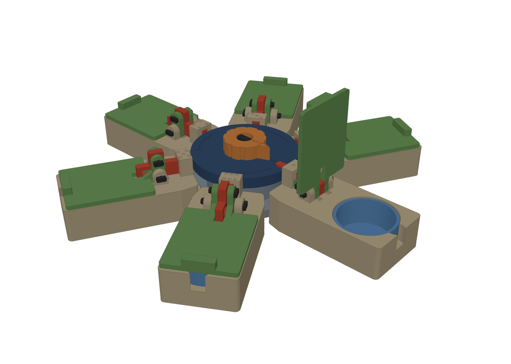
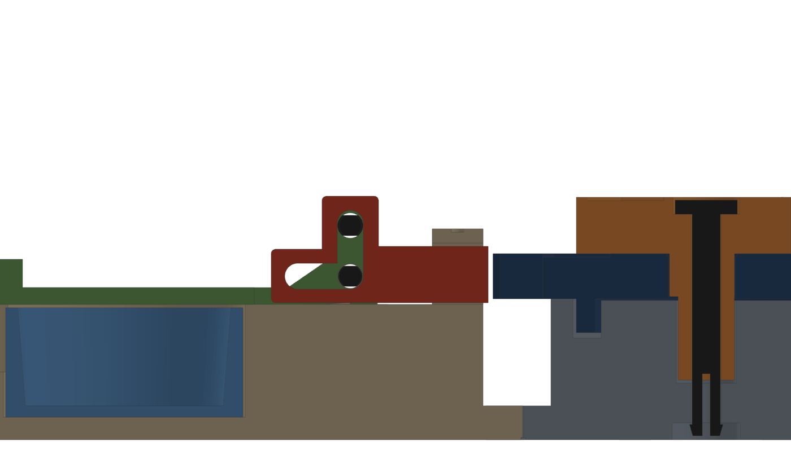
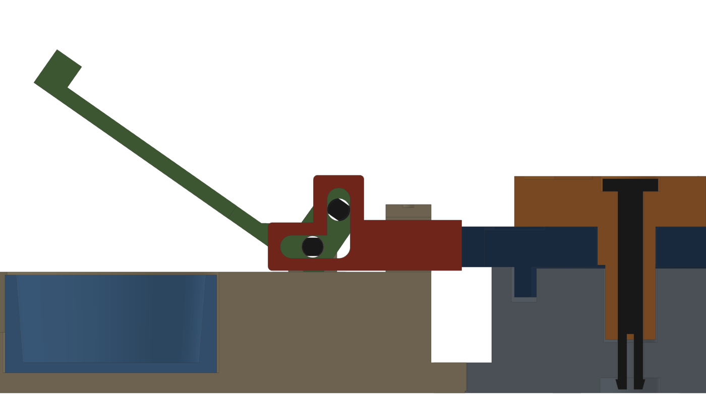
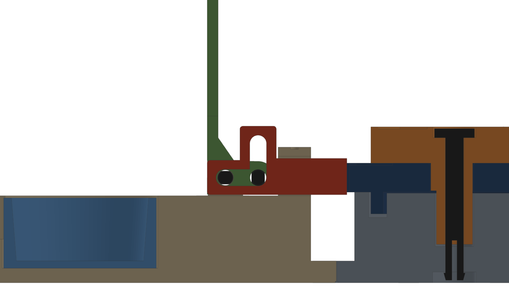
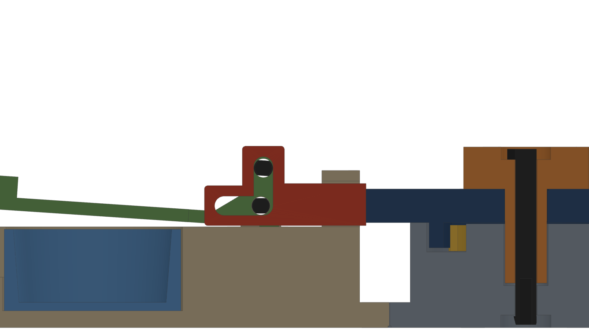
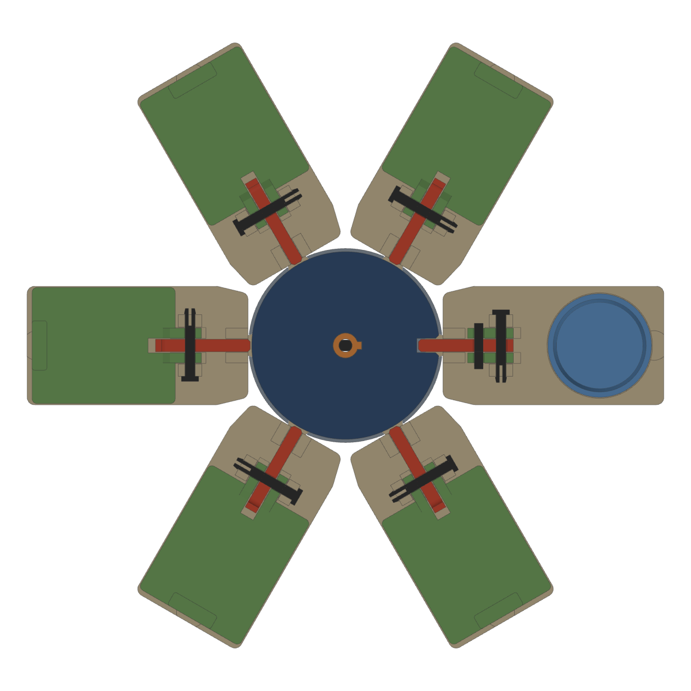
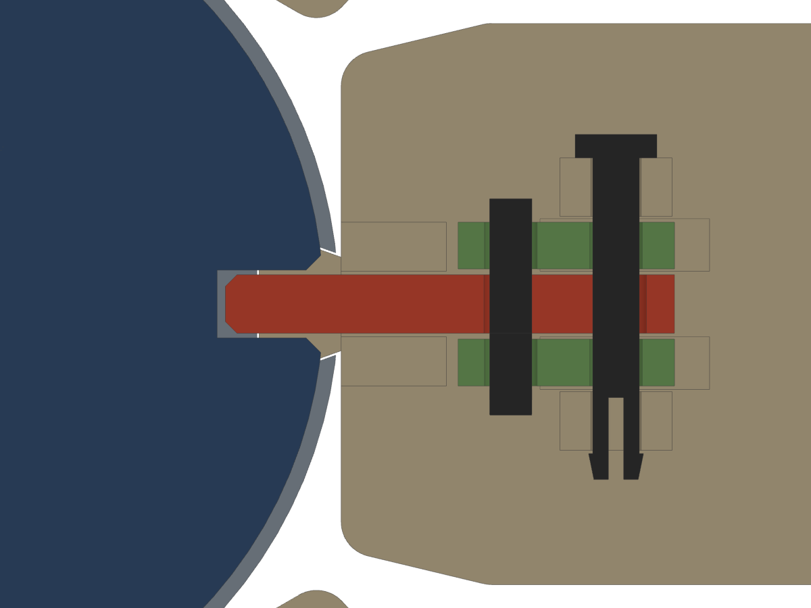
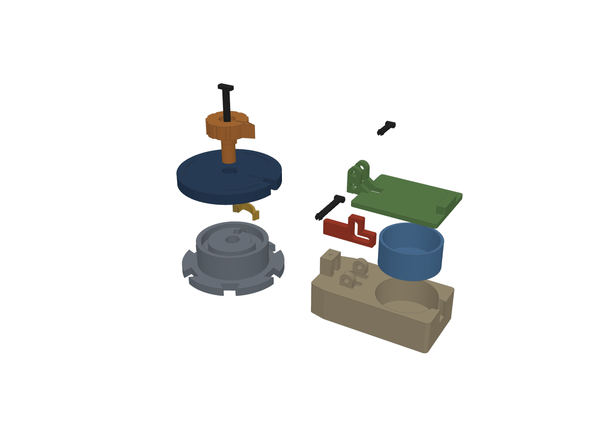

# Round feeding system for donkeys: mechanical interlock proof of concept

A small, fully 3D-printable working model of a **round feeding system with six feeding
stations, of which never more than one can be open at the same time**. It is purely
mechanical, with no springs, electronics or metal parts. The feeding position can only advance
around the circle in one direction, so the animal has to walk to the next station every time
the feed moves on.



| Overall size | Stations | Parts to print | Supports needed | Material | Filament |
|---|---|---|---|---|---|
| Ø 258 mm × 37 mm (lid open: 98 mm) | 6 | 41 + 5 spare pins (16 different STLs) | **none** | PLA or PETG | ≈ 450 g |

---

## 1. What the prototype demonstrates

| Requirement | How the design does it | Verified (see [verification report](docs/verification_report.md)) |
|---|---|---|
| Feeders placed around a round construction | 6 identical station modules slide into dovetails around a central hub | static interference check of the full 41-part assembly |
| Bowls can be opened and closed separately | every station has its own hinged lid and removable bowl | full 0→90° opening sweep, no collisions |
| **Never more than one feeder open** | single-notch selector disc + one locking bolt per station (rotary interlock, see §2) | exhaustive sweep: 1440 selector angles × 6 stations → max. **1** station openable |
| The mechanical locking actually works | lid drives its bolt through a Scotch-yoke crank: an open lid locks the selector, a locked selector blocks all other lids | non-selected lid stops after 3.8°; open lid limits selector to ±0.6° |
| Works without electronic control | 100 % mechanical: gravity-closed lids, positively driven bolts, printed flexure detent | – |
| Stimulates the donkey to move | one-way ratchet: the open station can only move forward around the ring; each step relocates the food | ratchet profile check: forward click, backward blocked |
| Truly printable / assemblable | all parts print flat without support, FDM clearances everywhere, snap pins, insertion paths checked | bed-fit, overhang analysis, assembly-path sweeps |

## 2. Working principle

```
             selector disc (one notch)                 station (one of six)
                     ┌──────┐            bolt                lid hinge
   knob ──► ( ○ )────┤notch ├◄───────[==========]──L-slot──┤ crank pin on lid
                     └──────┘
```

1. In the centre sits a **selector disc** with **one notch** in its rim. A knob turns it.
2. Each station has a flat **locking bolt** pointing radially at the rim of the selector.
3. The **lid** of each station rotates on a hinge pin. A second pin on the lid (the *crank pin*,
   9 mm from the hinge) runs in a vertical slot in the bolt. This is a Scotch yoke, so
   **lifting the lid pushes the bolt 9 mm towards the centre**, and closing the lid pulls it
   back. Both directions are driven positively, without springs.
4. **Not selected:** the bolt runs into the solid rim after 0.6 mm, so the lid cannot be lifted
   (it stops at ≈ 4°).
5. **Selected (notch in front of the bolt):** the lid opens fully and the bolt drops 8.4 mm deep
   into the notch. Now **the selector itself is locked**, so no other station can be selected
   while this lid is open. With no other station selectable, no other lid can open.
6. At full opening the crank is at dead centre, so the selector cannot push the bolt
   back (it is self-locking). The lid rests stably open against a hard stop.
7. To feed at the next place: close the lid → the bolt retracts → the selector is free →
   turn the knob counter-clockwise until it **clicks** → the next station is selected.
   A printed flexure pawl in the hub engages a ratchet ring under the selector. It gives a
   positive click at each station and blocks turning backwards.

| closed: bolt retracted | 35°: bolt half-way | open: bolt in the notch, selector locked |
|---|---|---|
|  |  |  |

**Non-selected station, someone tries to lift the lid:** the bolt tip hits the solid rim, and the
lid stops at 3.8°:



**Plan section at bolt height:** station 1 open, its bolt sits in the notch, and all other bolts
face solid rim:

| full view | detail of the notch |
|---|---|
|  |  |

**Indexing ratchet** (section through the hub, z = 22 mm): flexure pawl (yellow) in a pocket of
the ratchet ring (blue). Forward = gentle ramp + click; backward = radial wall.


### Why this makes the donkey move

Food is only ever reachable at one place, and that place can only move forward around the
ring, one station per step. It can never return to the bowl that was just emptied. On a real
installation (e.g. a ring of 6 m diameter) every step moves the food ≈ 3 m, and a full round
is ≈ 19 m of walking. In the prototype the knob is turned by hand. In a full-scale version the
same selector could be indexed by the farmer or by a purely mechanical timer (clockwork or
falling weight). The interlock itself does not change.

## 3. Parts list (BOM)

All files are in [`stl/`](stl), already in the correct print orientation.

| # | File | Qty | Recommended material | Notes |
|---|---|---|---|---|
| 01 | `01_hub.stl` | 1 | PLA/PETG | central base with dovetails, ratchet channel, pawl pocket |
| 02 | `02_selector_disc.stl` | 1 | PLA/PETG | printed **top face down**; engraved arrow marks the notch |
| 03 | `03_knob.stl` | 1 | PLA/PETG | keyed, so the pointer always points at the notch |
| 04 | `04_pawl_spring.stl` | 1 | **PETG preferred** (PLA OK) | flexure; 100 % infill |
| 05 | `05_station_module_1…6.stl` | 1 each | PLA/PETG | identical except for 1–6 dice pips on the bolt guide |
| 06 | `06_locking_bolt.stl` | 6 | PLA/PETG | print flat, ≥ 40 % infill |
| 07 | `07_lid.stl` | 6 | PLA/PETG | ears stand up from the plate |
| 08 | `08_bowl.stl` | 6 | PLA/PETG | removable |
| 09 | `09_hinge_pin.stl` | 6 (+2 spare) | PLA/PETG | Ø4 snap pin, grip 25 mm, 100 % infill |
| 10 | `10_crank_pin.stl` | 6 (+2 spare) | PLA/PETG | Ø4 snap pin, grip 14 mm, 100 % infill |
| 11 | `11_retaining_pin.stl` | 1 (+1 spare) | PLA/PETG | Ø5 snap pin, holds selector and knob down |

No hardware is needed. Alternative for the pins: M4 × 30 (hinge) and M4 × 20 (crank) screws with
nyloc nuts fit the same holes.

Reference assemblies for viewing (not for printing): [`assembly/`](assembly), as `.3mf` (coloured,
one object per part) and `.stl`, in the states "all closed" and "station 1 open".

## 4. Print settings

| Setting | Value |
|---|---|
| Nozzle / layer height | 0.4 mm / 0.2 mm (0.15 mm for pins and pawl if you like) |
| Perimeters | 3 (pins and pawl: 100 % infill) |
| Infill | 15–20 % for hub, modules, lids, bowls; ≥ 40 % for bolts and selector |
| Supports | **off**: no part needs them (only short bridges: bolt tunnel 5.6 mm, hole tops) |
| Brim | recommended for the pins and the pawl (small footprint) |
| Elephant-foot compensation | 0.1–0.2 mm if your slicer has it (bed-side fits already have 0.3 mm relief) |
| Bed | fits 220 × 220 mm; the largest part is a station module (97 × 48 × 37 mm) |

**Clearances built into the model** (per side unless noted):

| Fit | Clearance |
|---|---|
| bolt in its tunnel | 0.30 mm (sides), 0.6 mm total in height |
| bolt tip ↔ selector rim (closed) | 0.60 mm |
| bolt in notch (open) | 0.40 mm + 1.0 mm tip chamfer + 1.5 mm notch chamfer |
| pin Ø4.0 in cheek (fixed) / lid ear (rotating) / bolt slot (sliding) | Ø4.3 / Ø4.5 / 4.6 mm slot |
| lid ears ↔ bolt / ↔ cheeks | 0.50 mm |
| dovetail module ↔ hub | 0.20 mm (+0.3 mm first-layer relief) |
| knob key in selector | 0.20 mm (+0.3 mm first-layer relief) |
| knob axle in hub bore | 0.30 mm radial |
| pawl in its pocket | 0.25 mm |
| retaining pin Ø5.0 in Ø5.4 holes | 0.20 mm radial |

If your printer runs tight or loose, change the constants at the top of
[`cad/feeder.py`](cad/feeder.py) (`C_SLIDE`, `HOLE_*`, `SLOT_W`, `C_DOVE`, …) and regenerate (§7).

## 5. Assembly (≈ 20 minutes, no tools)



1. **Clean up** the parts. Check that the pins pass through their holes (a Ø4.5 drill run through
   the lid ears by hand is a quick fix if a hole printed small).
2. **Pawl → hub.** Drop the pawl spring into its pocket in the top of the hub column. The anchor
   only fits one way; the bump points outwards into the ring channel.
3. **Bolt → module** (one station at a time). Slide the bolt into the tunnel of the guide block
   from the outer side, tip first, with the tall L-slot part up and towards the bowl.
4. **Lid → module.** Lower the lid so its two ears straddle the tall part of the bolt, between the
   two hinge cheeks. With the lid closed and the bolt pulled outwards, all holes line up.
   - Push a **hinge pin** (long) through cheek → ear → bolt (horizontal slot) → ear → cheek
     until the split tip snaps out behind the far cheek.
   - Push a **crank pin** (short) through ear → bolt (vertical slot) → ear until it snaps.
   - Check: lifting the lid now slides the bolt 9 mm out of the inner end of the module; closing
     the lid pulls it back.
5. **Bowl** into its pocket (the finger notch at the outer end helps to take it out).
6. **Modules → hub.** Put the hub on the table. With all lids **closed**, slide each module down
   into its dovetail: stations 1–6 counter-clockwise (count the pips on the bolt guides).
7. **Selector disc.** Lower it onto the hub, ratchet ring down. Turn it slightly counter-clockwise
   until the pawl clicks into a pocket.
8. **Knob.** Insert it into the selector: the key only fits one way, with the pointer over the notch.
9. **Retaining pin.** Push it down through the knob and the hub until it clicks under the hub.
   The selector and knob can now no longer be lifted off. To dismantle: tilt the hub, squeeze
   the two prongs under the hub together and push the pin up.

To replace a module, remove the retaining pin, knob and selector first. The selector rim lies
over the module dovetails, which also keeps the modules in place.

## 6. Demonstration / acceptance test after printing

Do these tests on the assembled prototype. Expected results in **bold**.

| # | Action | Expected |
|---|---|---|
| T1 | Turn the knob until it clicks with the pointer at station 1. Lift lid 1. | **Opens fully (≈ 90°), stays open**; bowl 1 accessible |
| T2 | With lid 1 open, try to turn the knob either way. | **Blocked** (tiny play only) |
| T3 | With lid 1 open, try to lift each of the lids 2–6. | **All blocked** after a few degrees |
| T4 | Open lid 1 only part-way (≈ 20°) and try the knob. | **Blocked** |
| T5 | Close lid 1 and turn the knob counter-clockwise. | **One click** at station 2; lid 2 opens, lid 1 is now locked |
| T6 | Try to turn the knob clockwise (backwards). | **Blocked** by the ratchet |
| T7 | Stop the knob half-way between two stations and try all lids. | **No lid opens** |
| T8 | Go round all six stations. | Each opens exactly when selected, **never two at once** |
| T9 | Try to pull the knob / selector upwards. | **Held** by the retaining pin |

**Expected behaviour of a locked lid:** the CAD model gives 3.8° (≈ 4 mm at the front edge)
before the bolt meets the rim. On a printed part the pin clearances add play, so expect up to
≈ 8–10° (≈ 10 mm at the front edge). After that the lid stops hard, and the bowl stays
covered. A full-scale version made with tighter tolerances will have proportionally less play.

## 7. Design files and regeneration

The design is fully parametric Python ([manifold3d](https://github.com/elalish/manifold) solid
modelling):

| File | Purpose |
|---|---|
| [`cad/feeder.py`](cad/feeder.py) | all parameters and part geometry; the working principle is documented at the top |
| [`cad/build.py`](cad/build.py) | exports the STLs in print orientation and the reference assemblies |
| [`cad/verify.py`](cad/verify.py) | mechanical and printability verification → [`docs/verification_report.md`](docs/verification_report.md) |
| [`cad/make_images.py`](cad/make_images.py), [`cad/render.py`](cad/render.py) | documentation renders (needs Node + Playwright + three.js) |

```bash
pip install -r cad/requirements.txt
python3 cad/build.py      # -> stl/, assembly/
python3 cad/verify.py     # -> docs/verification_report.md  (exit code 1 if any check fails)
```

### What the verification covers (all passing)

* every part is one closed, valid solid;
* the complete 41-part assembly has no overlapping solids (closed, open, other selector positions);
* clearance table of every moving interface;
* the selected lid swings 0→90° (37 positions) without touching anything;
* every non-selected lid is stopped by the rim; forcing it would push 146 mm³ of bolt into the
  solid selector;
* an open lid (fully or partly) blocks the selector;
* **exhaustive one-at-a-time proof:** 1440 selector angles × 6 stations, never more than one
  station openable (plan-view model, cross-checked against the 3D model to 0.014 mm);
* ratchet: pawl unloaded at each station, gentle forward ramp, radial wall backwards, maximum
  flexure strain ≈ 0.7 %;
* assembly paths: every part can be inserted along a straight path without passing through
  another part; retention of selector and knob;
* printability: bed fit, flat on the bed, overhang and bridge areas per part.

## 8. Limits of this proof of concept

* The knob is turned by hand. The prototype proves the **interlock and sequencing**; the
  timing/drive of a real installation is a separate module that would turn the same selector.
* The lids close by gravity. The interlock never depends on that: a lid that is not fully closed
  keeps the selector locked.
* The 6-station geometry is fixed in this version (`N` is a parameter, but other station counts
  need a narrower module).
* A prototype for demonstration only: it is not food-safe and not meant for use with real animals.
